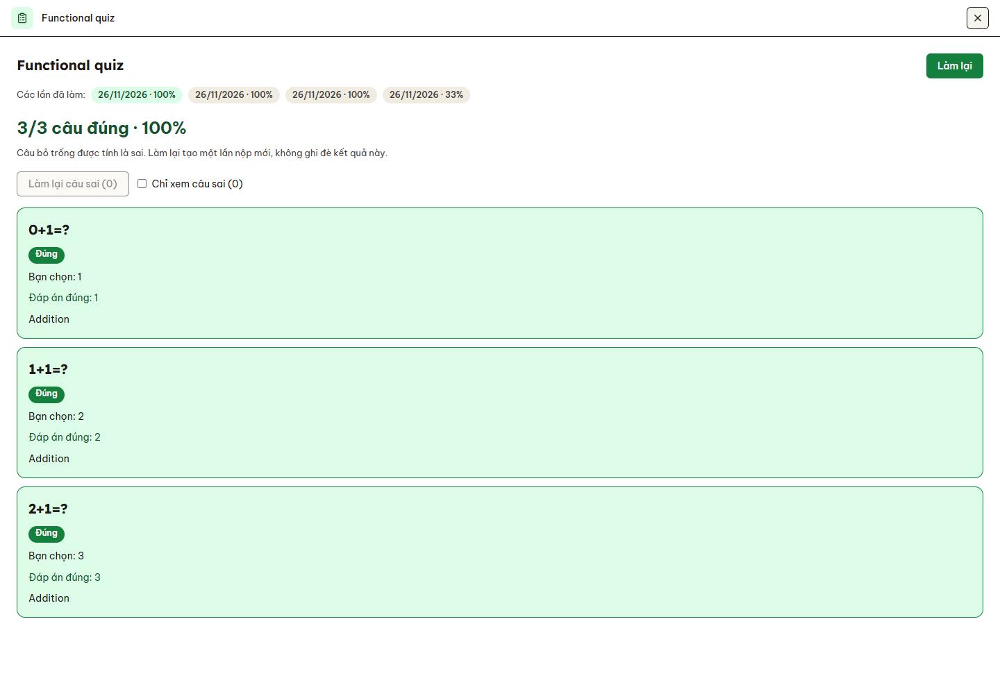

# Kiểm chứng các bản sửa chức năng — 26/11/2026

Ưu tiên hiện tại: ổn định luồng học với **một môn**. Kiểm chứng Chrome dùng một môn và một quiz mẫu, tập trung vào làm lại, nộp bài và lịch sử. Phần ôn nhiều môn là sửa lỗi đã phát hiện; không yêu cầu chuyển sang dùng nhiều môn để kiểm tra luồng hiện tại.

## Lỗi và thay đổi

| Lỗi trước khi sửa | Thay đổi và kiểm chứng |
| --- | --- |
| Nộp quiz sau khi chọn “Làm lại” quay về màn hình làm bài dù đã lưu kết quả | `initialAttemptId` trước đây lấy từ kết quả mới nhất ở mỗi render. Khi lưu bài, giá trị này đổi và effect khởi tạo chạy lại với `autoStart=true`, tạo bản nháp mới. Chụp cố định ID khi mở quiz; Chrome kiểm chứng hai lần nộp liên tiếp vẫn ở màn hình kết quả. |
| Lịch sử bị nhân đôi sau khi đồng bộ | Đối chiếu cả `id` và `backendResultId`; có unit test và kiểm chứng tải lại trang. |
| API lịch sử quiz trả 422 | Đăng ký `/history/results` trước `/{quiz_id}/results`, tránh đọc `history` thành UUID; API thực trả 200. |
| Bỏ trống câu trả lời nhưng backend tính điểm theo số câu đã trả lời | Tính điểm trên toàn bộ câu hỏi, giống frontend; đúng 1/3 câu trả khoảng 33,33%. Chặn câu trùng, câu ngoài quiz và lựa chọn ngoài phạm vi trước khi ghi dữ liệu. |
| Nộp bài có nhiều lần commit và lỗi lưu bị bỏ qua trên UI | Ghi kết quả, đáp án, lịch ôn trong cùng giao dịch; khóa nộp lặp và thay đáp án khi đang gửi. Nếu lưu server thất bại, thông báo kết quả chỉ lưu trong trình duyệt. Chưa đo hiệu năng trên PostgreSQL thực tế. |
| Vào lớp báo lỗi dù đã thêm thành viên | Trả đủ `teacher_id` và số thành viên thực tế theo schema; kiểm chứng bằng API và trình duyệt. |
| Quiz ôn nhiều môn lỗi do thiếu `subject_id`, hoặc mất khi khôi phục localStorage | Cho phép môn trống đối với quiz review/wrong; thêm migration PostgreSQL và test hydrate. Lọc môn trước khi giới hạn số câu ôn, tránh trả thiếu hoặc 404 giả. |
| Không nhận diện từ “đồ thị”, “biểu đồ” | Chuẩn hóa `đ` thành `d` trước khi so khớp; các test figures chạy với dữ liệu/mock, không gọi AI. |
| Backend không khởi động với cấu hình cũ/Python 3.11 | Chấp nhận biến legacy `AI_WORKER_URL`; tách f-string chứa xuống dòng để tương thích Python 3.11. Không thay khóa API hay `.env` cá nhân. |

## Kết quả thực chạy

Môi trường: Windows, Python 3.11, Node 24, Chrome headless, backend thật trên SQLite riêng và frontend dev server. Đây là kiểm tra chức năng cục bộ, chưa phải chứng nhận ổn định production.

| Kiểm tra | Kết quả |
| --- | --- |
| Backend `pytest -q -k "not test_chat" --disable-warnings` | 44 passed, 1 deselected; 21 warnings |
| Frontend `node scripts/run-tests.mjs` | 44 passed, 0 failed |
| TypeScript `pnpm exec tsc --noEmit` | Exit 0 |
| ESLint các file frontend thay đổi | Exit 0 |
| API HTTP thực | 39/39, [chi tiết JSON](evidence/api-results.json) |
| Chrome: landing, đăng nhập/dashboard, tạo môn, vào lớp | 4/4, không có page error; [chi tiết JSON](evidence/browser-results.json) |
| Chrome: nộp lại hai lần, không còn bản nháp/không gọi AI, tải lại không nhân đôi lịch sử | 4/4; [chi tiết JSON](evidence/quiz-browser-results.json) |

Ảnh sau lượt nộp thứ hai: vẫn hiện **3/3 câu đúng · 100%** và nút **Làm lại**; không trở về form nhập đáp án.

## Chạy lại

Backend: cài `backend/requirements.txt` và `backend/requirements-dev.txt`, rồi chạy lệnh pytest ở bảng trên từ `backend/`. Fixture tự dùng SQLite tạm và chặn lời gọi AI thật. `test_chat` được loại khỏi lượt kiểm thử theo yêu cầu.

Frontend: cài dependency theo lockfile, dùng Node 24, chạy `pnpm test` từ `frontend/`.

Bộ smoke có thể chạy lại từ thư mục gốc repository bằng Python đã cài dependency backend và `playwright`:

1. Terminal 1: `python scripts/functional-check/runtime.py`. Runtime chỉ dùng database trong thư mục temp `tuhoc-functional-check`, khóa AI và lắng nghe `127.0.0.1:8000`.
2. Terminal 2: `python scripts/functional-check/api-check.py`. Script tạo tài khoản/quiz mẫu và xuất báo cáo, fixture đăng nhập vào cùng thư mục temp. Cần runtime ở bước 1 để tránh gọi nhầm server khác.
3. Chạy frontend với `NEXT_PUBLIC_API_BASE_URL=http://localhost:8000/api` tại `http://localhost:5173`.
4. `python scripts/functional-check/browser-quiz-check.py`. Cần Chromium của Playwright (`python -m playwright install chromium`), hoặc đặt `CHROME_EXECUTABLE` trỏ tới Chrome đã cài. Script chặn endpoint chat/chấm bài/hỏi tài liệu, rồi kiểm chứng hai lượt làm lại và tải lại trang.

Các terminal phải dùng cùng thư mục temp. Những file fixture đăng nhập và database tạm không nằm trong repository. Ảnh/JSON đã commit là minh chứng của lượt kiểm thử cục bộ ngày nêu trên.

## Điều kiện triển khai và giới hạn

- Chạy `backend/migrations/001_cross_subject_reviews.sql` trên PostgreSQL hiện có trước khi dùng ôn tập nhiều môn. Migration bỏ ràng buộc NOT NULL, không xóa dữ liệu. Chưa áp dụng hoặc kiểm chứng migration trên PostgreSQL thực trong lượt này.
- Không chạy chat AI, sinh quiz bằng AI, embedding, xử lý PDF thật hoặc chấm tự luận bằng AI. Quiz và tài liệu kiểm thử là fixture. Chưa đánh giá độ trễ dịch vụ ngoài hay tải đồng thời.
- Các warnings backend gồm cảnh báo thư viện/phụ thuộc; test không có failure. Kết quả cũ đã lưu không được tính lại điểm.
